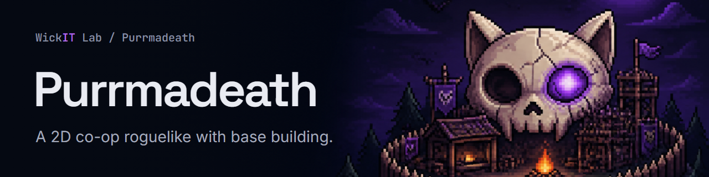

<p align="center">
  
</p>

**2D co-op roguelike survival with base building, a procedural world and up to 4 players**

Purrmadeath is a top-down survival game: you build a base around a campfire, hold it against waves of enemies and bosses, and level one of three classes through skill trees, cards and achievements. It plays offline in singleplayer, or online with friends through an invite code or a server IP. The current version is 1.4.0; see [CHANGELOG.md](CHANGELOG.md) for release notes.

Built with Electron, Pixi.js and a Node.js WebSocket game server written in TypeScript. The desktop client ships as a Windows installer with an embedded local server for singleplayer, and the same server code runs hosted on an AWS EC2 instance for online play. Download the installer from the [Releases](https://github.com/w1ck3ds0d4/Purrmadeath/releases) page; installed copies update themselves in the background.

## Contents

- [Tech stack](#tech-stack)
- [Prerequisites](#prerequisites)
- [Getting started](#getting-started)
- [Environment variables](#environment-variables)
- [Features (built)](#features-built)
- [Controls](#controls)
- [Debug tools](#debug-tools)
- [Testing](#testing)
- [Releasing a new version](#releasing-a-new-version)
- [AWS instance management](#aws-instance-management)
- [Project structure](#project-structure)
- [Security](#security)
- [What's not yet built](#whats-not-yet-built)
- [License](#license)

## Tech stack

| Layer | Technology |
| --- | --- |
| Language | TypeScript (strict) |
| Desktop client | Electron, with a preload IPC bridge |
| Rendering | Pixi.js 8 (canvas) |
| Game server | Node.js with the `ws` WebSocket library, server-authoritative ECS systems |
| World generation | `simplex-noise` |
| Build | `electron-vite`, `esbuild` (bundled server), `electron-builder` (Windows NSIS installer) |
| Auto-update | `electron-updater` against GitHub Releases |
| Tests | Vitest |
| CI/CD | GitHub Actions: lint, typecheck, tests, installer build, and a manual EC2 deploy workflow |

## Prerequisites

- Node.js 20 or newer and npm
- Developer Mode enabled on Windows (needed for the `electron-builder` symlink extraction)
- To only play: nothing, use the installer from the [Releases](https://github.com/w1ck3ds0d4/Purrmadeath/releases) page

## Getting started

1. Clone the repo and install dependencies:

   ```bash
   git clone https://github.com/w1ck3ds0d4/Purrmadeath.git
   cd Purrmadeath
   npm install
   ```

2. Start the Electron app with its embedded local server:

   ```bash
   npm run dev
   ```

3. Optionally run only the game server, with auto-reload (it listens on port 7777 unless `PORT` is set):

   ```bash
   npm run server:dev
   ```

The dev build connects to `localhost` automatically. To test a production server, type its IP in the invite code field and click Join.

Other scripts: `npm run build` (electron-vite build), `npm run build:win` (Windows installer), `npm run lint`, `npm run typecheck`, `npm run check-version`.

## Environment variables

| Variable | Used by | Default | Purpose |
| --- | --- | --- | --- |
| `PORT` | Game server | `7777` | Port the server listens on, for cloud deployments |
| `LOG_DIR` | Game server | `./logs` | Where timestamped session logs are written |
| `SAVES_DIR` | Game server | `./saves` | Where player saves are stored |
| `METASTATS_DIR` | Game server | `./metastats` | Where achievement and meta stats are stored |
| `NODE_ENV` | Game server | unset | `production` enables the per-IP connection cap |
| `VITE_SERVER_IP` | Client build | unset | Online server address baked into the client at build time; unset means a dev build that targets `localhost`. Put it in `.env.production` for `npm run build:win` |

## Features (built)

### Game modes

- **Singleplayer**: play offline against a local embedded server. Saves are stored locally and it works without internet.
- **Host game**: create an online session; other players join with the invite code.
- **Join**: enter an invite code or a server IP to join an existing session.

### Classes

Three base classes, each with three active subclasses and two placeholder subclasses that unlock through achievements:

- **Warrior**: sword, 120 HP, 180 speed, 2 defense
  - Berserker (lifesteal, rage), Guardian (tank, thorns, charge), Blood Knight (drain, arc)
  - Templar and Slayer (achievement-locked placeholders)
- **Ranger**: bow, 80 HP, 220 speed
  - Sharpshooter (poison, crit), Beastmaster (wolf companion), Trapper (multi-shot, explosives)
  - Shadow Hunter and Windwalker (achievement-locked placeholders)
- **Mage**: staff, 70 HP, 200 speed
  - Fire (burn, meteor), Frost (slow, blizzard), Electric (chain, thunderwave)
  - Earth and Void (placeholders)

Each subclass has a 10-tier skill tree with passive stats, combat modifiers, abilities and ultimates.

### Buildings

Buildings are organised by category in the build menu (Q):

- **Defense**: Wall, Gate, Arrow Turret, Cannon Turret, Ballista, Laser Tower, Tesla Coil, Flame Tower, Catapult, Flak Cannon, Moat, Spike Trap
- **Production**: Lumbermill, Quarry, Mine, Farm, Workshop, Smeltery (produces steel from wood and iron)
- **Military**: Guard House (trains random-role guards; costs a civilian, food, steel and gold)
- **Housing**: Cat House (housing for additional civilians)
- **Utility**: Warehouse, Bridge, Light Tower, Healing Shrine, Repair Station, Teleporter Pad
- **Shops**: Potion Shop, Tavern (hire hero NPCs), Market (daily card shop: 3 random cards per wave, buy 1 with gold, 1 max per game)

### Points of interest

The procedural world contains discoverable POIs, drawn as diamond shapes with "?" markers:

- **Abandoned Camp**: loot resources (press E to interact)
- **Shrine**: grants a temporary blessing (speed, damage, regen or defense) for 120 seconds; active blessings show in the top-right HUD with countdown timers
- **Enemy Nest**: triggers a mini-wave when approached (150 px proximity)
- **Treasure Chest**: contains rare resources (press E to open)

### Campfire and building range

The campfire is placed by the player at the start (free) and serves as the respawn point and initial housing. Building is limited to an 80-tile (2560 px) square around the campfire; Watchtowers extend the range by 20 tiles per level, and portals spawn outside it. Destroying the campfire ends the game, and dying before it is placed is permanent death. Exclusion zones stop placement too close to certain structures (walls, bridges, moats and spike traps are exempt). Buildings can be relocated within the range.

### Cards and achievements

- **30 cards**: 15 stat buffs (common to legendary), 10 build-defining abilities and 5 curses (a buff and a debuff in one).
- **18 achievements**: 10 stat buffs, 4 building unlocks and 4 class unlock milestones.
- Cards are offered every 3 waves (pick 1 of 3) and granted on boss kills. Achievement buffs persist across runs.

### Boss encounters

Eight unique bosses, one every 5 waves (W5 through W40), with multi-phase mechanics, HP thresholds and boss-specific loot tables. Double bosses appear from W30.

## Controls

| Action | Key |
| --- | --- |
| Move | W A S D |
| Attack | Left mouse button |
| Interact / upgrade | E |
| Sprint | Shift (hold) |
| Dodge roll | Space |
| Ability 1 / 2 / 3 | 1 / 2 / 3 |
| Use potion | 4 |
| Build mode | Q |
| Rotate building | Scroll wheel (in build mode) |
| Place building | Left mouse button (in build mode) |
| Select building | Right mouse button |
| Repair building | R |
| Demolish building | X |
| Move building | F (with a building selected) |
| Civilian panel | C |
| Skill tree | K |
| Chat | Enter |
| Pause / close | Escape |
| Toggle controls | F1 |
| Debug console | F4 |

## Debug tools

- **F4**: debug console with a 3-column stats view: Core (FPS, entities, position), Server (wave, enemies, tick profile) and Game (class, HP, kills).
- **F12** or **Ctrl+Shift+I**: Electron DevTools (dev mode only).
- **Debug commands** (typed in the debug console): `/sp`, `/spawn`, `/give`, `/card`, `/wave`, `/kill`, `/pause`, `/god`, `/speed`, `/heal`, `/tp`, `/all`.
- **Session logs**: the server writes timestamped logs to `logs/` (ability activations, damage, buffs, wave events, saves).
- **Client logs**: production builds write startup and connection logs to `%AppData%/purrmadeath/logs/`.
- **Rate monitor**: localhost connections log average and peak message rates every 30 seconds.

## Testing

Tests use [Vitest](https://vitest.dev/) and cover server-side systems such as pathfinding, combat and enemy AI, plus shared definitions and the protocol.

```bash
npm run test          # run all tests once
npm run test:watch    # run tests in watch mode
```

Test files live under `tests/` (`tests/server`, `tests/shared`).

## Releasing a new version

### Automated (recommended)

1. Bump the version in both `package.json` and `GAME_VERSION` in `shared/constants/core.ts`. They must match; `npm run check-version` verifies it.
2. Commit and tag:

   ```bash
   git add -A
   git commit -m "(release) vX.X.X"
   git tag vX.X.X
   git push && git push --tags
   ```

3. The `release.yml` GitHub Actions workflow then builds the Windows installer, creates a GitHub Release with the installer and auto-updater files. Existing installs update on their next launch. The server is deployed separately by the manually run `deploy.yml` workflow (input: `ref`, a branch or tag), which updates the code on the EC2 server over SSH and restarts the game server.

Required GitHub secrets (`VITE_SERVER_IP` is used by `release.yml`; `EC2_HOST` and `EC2_SSH_KEY` by `deploy.yml`):

| Secret | Description |
| --- | --- |
| `VITE_SERVER_IP` | Elastic IP of the EC2 instance |
| `EC2_HOST` | Same as `VITE_SERVER_IP` (SSH host) |
| `EC2_SSH_KEY` | Private SSH key for the `ec2-user` account |

### Manual

For when CI is down.

1. Make sure `.env.production` exists in the project root (`VITE_SERVER_IP=xx.xx.xx.xx`), then build the installer. It is written to `dist/Purrmadeath Setup <version>.exe`:

   ```bash
   npm run build:win
   ```

2. Create the GitHub release. `latest.yml` and the `.blockmap` must be included or the auto-updater will not work:

   ```bash
   gh release create vX.X.X "dist/Purrmadeath Setup X.X.X.exe" "dist/Purrmadeath Setup X.X.X.exe.blockmap" dist/latest.yml --title "Purrmadeath vX.X.X"
   ```

3. Deploy the server code, either with the deploy script (needs `purrmadeath-key.pem` in the project root):

   ```bash
   bash deploy/deploy.sh YOUR_ELASTIC_IP
   ```

   or by hand on the instance:

   ```bash
   ssh -i purrmadeath-key.pem ec2-user@YOUR_ELASTIC_IP
   cd /opt/purrmadeath
   sudo -u purrmadeath git fetch origin && sudo -u purrmadeath git reset --hard origin/main
   sudo -u purrmadeath npm install --include=dev
   sudo systemctl restart purrmadeath-server
   sudo systemctl status purrmadeath-server
   ```

## AWS instance management

The game server runs on an EC2 `t3.micro` instance in `eu-west-2` with an Elastic IP. The Elastic IP is free only while the instance is running, so stop the instance when it is not in use.

```bash
# start, stop, check state
aws ec2 start-instances --instance-ids YOUR_INSTANCE_ID --region eu-west-2
aws ec2 stop-instances --instance-ids YOUR_INSTANCE_ID --region eu-west-2
aws ec2 describe-instances --instance-ids YOUR_INSTANCE_ID --region eu-west-2 \
  --query "Reservations[0].Instances[0].State.Name"
```

On the instance:

```bash
sudo systemctl status purrmadeath-server     # service state
sudo systemctl restart purrmadeath-server    # restart
sudo journalctl -u purrmadeath-server -f     # live logs
sudo journalctl -u purrmadeath-server -n 100 # last 100 lines
```

Player saves live on the server in `/opt/purrmadeath/saves/` as JSON files. They persist across restarts and redeployments, so back the directory up before wiping the instance. The `deploy/` folder holds the provisioning and teardown scripts, and `npm run aws:start`, `aws:stop` and `aws:status` wrap the instance controls.

## Project structure

```
server/                    Game server (Node.js + ws)
  core/                    Core orchestration
    GameSession.ts           Session logic, tick loop, combat, waves
    GameLogger.ts            Persistent file-based session logging
    SessionManager.ts        Session management, reconnection, meta stats
  systems/                 ECS systems (combat, enemies, movement, projectiles)
  abilities/               Ability execution (AbilityExecutor.ts)
shared/                    Shared between client and server
  components/              ECS component definitions
  constants/               Game balance, version, building costs
  protocol.ts              WebSocket message types
  definitions/             Data definitions
    skills/                Per-class skill trees (WarriorSkills, RangerSkills, MageSkills)
    CardDefinitions.ts     30 cards (buffs, abilities, curses)
    ProgressionDefinitions.ts  18 achievements
    SkillDefinitions.ts    Skill types, allocation logic, buff computation
    ClassDefinitions.ts    Class stats (Warrior, Ranger, Mage)
  world/                   Tile registry, world generation
  SaveFormat.ts            Save file data structures
src/
  main/index.ts            Electron main process, embedded server, auto-updater
  preload/index.ts         Electron preload (IPC bridge)
  renderer/src/            Client (Pixi.js)
    game.ts                  Main game loop, state management
    input/                   Input manager, keybindings
    net/                     WebSocket client, message handlers, reconciliation
    systems/                 Rendering systems (players, projectiles, VFX)
    ui/                      HUD, overlays (build menu, skill tree, civilian panel)
    render/                  Camera, tile renderer, build ghost
tests/                     Vitest suites for server and shared code
deploy/                    EC2 provisioning, deploy and teardown scripts
scripts/                   Version check and AWS helper scripts
```

More detail is in [ARCHITECTURE.md](ARCHITECTURE.md) and [HOW_IT_WORKS.md](HOW_IT_WORKS.md).

## Security

The server is server-authoritative with connection caps, a 64 KB payload limit, per-client rate limiting and message validation. The Electron client runs with `contextIsolation` on, `nodeIntegration` off, a Content Security Policy and a restricted preload bridge. See [SECURITY.md](SECURITY.md) for the threat model, known limitations and the hardening roadmap.

To report a vulnerability, email support@wickitlab.com and do not open a public issue. Installers are currently unsigned, so Windows SmartScreen warns on first run, and local save files are plain JSON without an integrity check.

## What's not yet built

- Achievement-locked placeholder subclasses: Templar, Slayer, Shadow Hunter, Windwalker, Earth and Void.
- Dragon Roost building (listed as coming soon).
- Audio: combat SFX and per-biome or per-wave music (parked in the [roadmap](ROADMAP.md)).
- Client render tests for the HUD, building placement and combat UI (parked).
- Windows code signing and tamper detection for save files.

The project is in maintenance mode: new features wait until the maintainer reopens it. See [ROADMAP.md](ROADMAP.md).

## License

This project is dual-licensed:

- [AGPL v3](LICENSE) - free for open-source use. Derivatives and SaaS deployments must release their source under AGPL.
- [Commercial license](COMMERCIAL.md) - for proprietary or closed-source use, or hosted services that do not want to comply with the AGPL source-disclosure requirements. Contact support@wickitlab.com for terms.
